# 2.1. Naive Bayes

El algoritmo de Naive Bayes o los clasificadores de Naive Bayas representan un algoritmo de aprendizaje automático supervisado; a su vez, pertenece a la familia de los algoritmos de aprendizaje generativo. Esto significa, que ha diferencia de algoritmos como los Clasificadores Discriminantes, permite al modelo aprender la distribución estadística de los datos de entrenamiento para crear contenido nuevo y original [(IBM, 2021)](https://www.ibm.com/mx-es/think/topics/naive-bayes). 

Los **Clasificadores de Naive Bayes** derivan directamente del **Teorema de Bayes**. Antes de especificar qué es el clasificador de Naive Bayes, deberemos definir los conceptos base del Teorema de Bayes.

## Conceptos clave
- **Probabilidad Condicional** => Probabilidad de que al observar un evento (X=i) otro evento se dé (Y=i), ello se denota como P(Xi,Yi).

- **Probabilidad Posterior** => Probabilidad de un resultado después de que se haya incorporado la información del predictor.

## Teorema de Bayes

El teorema de Bayes nos permite actualizar la probabilidad de una hipótesis (resultado a priori) basada en la evidencia o información resultante (posterior). 

**Fórmula Extendida del Teorema de Bayes**
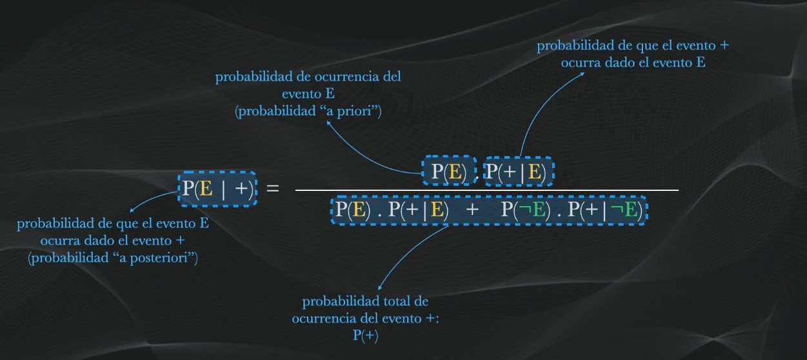

**Descripción:**

- `P(E | +)` => Probabilidad de que el suceso **E** ocurra dado el evento **+**. 
- `P(+ | E)` => Probabilidad de que el suceso **+** ocurra dado el evento **E**. 
- `P(-E | +)` => Probabilidad de que el suceso **E** NO ocurra dado el evento **+**. 
- `P(+ | -E)` => Probabilidad de que el suceso **E** ocurra dado NO ocurra el evento **-E**.

Aunque los términos inicialmente sean algo complejos de entender, en realidad es algo bastante sencillo. Véalo de la siguiente manera:

Supongamos que el evento `+` ejemplifica un caso de PHISHING, mientras que `E` ejemplifica los factores que pueden llevar a ello, por ejemplo: Antivirus desactivado, usuario sin competencias digitales, etc.

El Teorema de Bayes nos permite evaluar cuál es la posibilidad, de que, dado las características de que un Usuario tenga el Antivirus desactivado pueda sufrir un ataque de phishing. Para realizar ello, primero planteemos los datos.

```
Por ejemplo, si solo tuviéramos una estadística suelta, como decir que de cada 10 trabajadores, 2 pasan por un ataque de phishing
```

Si tenemos 50 trabajadores.


Nota. Los usuarios en color amarillo son los que posiblemente sufran de un ataque de phishing.

En este caso, sería un hecho que:

`P(E) = Cant. Usuarios Afectados / Total = 10/50 = 20%`

Pero, esto es muy especulativo, ya que una métrica, frente a una encuesta real podría no ser del todo exacta. Para ello, establecemos 2 grupos de usuarios: PHISHING (experimentaron el ataque), NO PHISHING (No experimentaron el ataque).

A su vez, establecemos nuestra primera variable predictora: **Antivirus (activado o no)**.

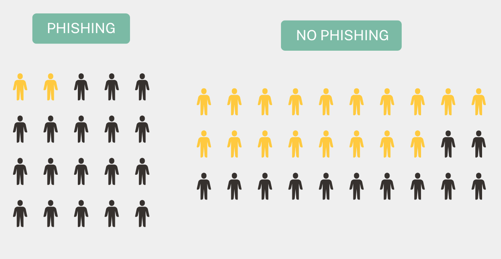
Nota. Los usuarios en amarillo simbolizan los que tienen el antivirus activado.

```
Ante esto, nos preguntamos:

¿Cuál es la probabilidad, de que teniendo el antivirus activado, sufra de un ataque de phishing?
```

Realizamos los cálculos de la fórmula:

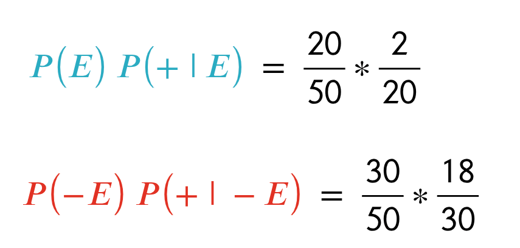

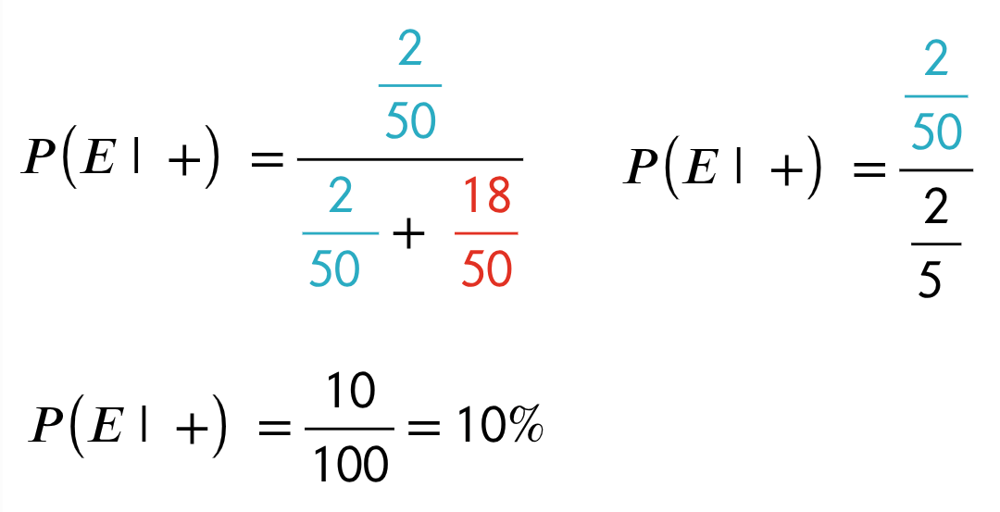

Por tanto, concluimos: 

```
Si los usuarios tienen el antivirus activado, hay un 10% de probabildad de que pasen por un ataque de phishing.
```

Pero, si ahora agregamos una variable predictora adicional: **Competencias Digitales**.

```
Ahora nos preguntaríamos:

¿Cuál es la probabilidad, de que teniendo el antivirus activado y contando con competencias digitales, sufra de un ataque de phishing?
```

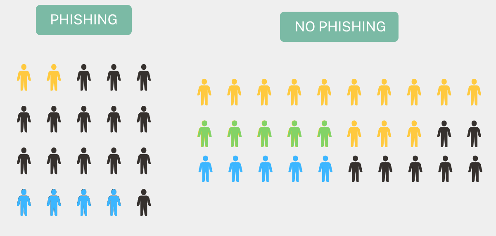
Nota. El color amarillo simboliza el Antivirus, el color celeste representa las competencias digitales y el verde usuarios con ambas variables predictoras.

Si ante este caso solo usamos el teorema de Bayes, tendremos lo siguiente:

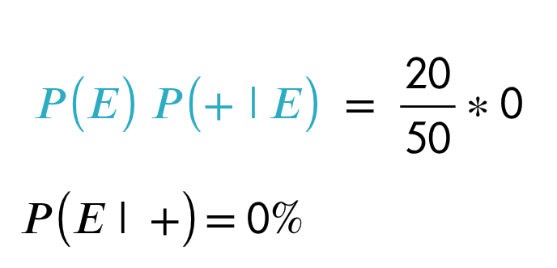

Dado que, como vimos en la clasificación anterior, no existen usuarios que hayan sufrido phishing que hayan tenido el **antivirus activado** y presenten **competencias digitales**, su valor es 0, lo cual, anula todo el resultado.

Esto nos lleva a concluir:

```
Si los usuarios tienen el antivirus activado y tienen competencias digitales, hay un 0% de probabildad de que pasen por un ataque de phishing.
```

### Aplicación de los **Clasificadores de Naive Bayes**
Pero, ¿esto  realmente es correcto?, anteriormente vimos que hay casos de Phishing donde los usuarios tienen o el **antivirus activado** o los usuarios presentan **Competencias Digitales**.

Aquí nace el algoritmo de los **Clasificadores de Naive Bayes**. Estos clasificadores nos permiten realizar una clasificación basada en múltiples variables predictoras. En este caso, lo diferente viene en ser "ingenuos", debemos asumir que ambas variables predictoras son independientes, que no existe una relación entre ellas. Tal vez suene algo inexacto o iluso realizar ello, pero es la magia del algoritmo de los **Clasificadores de Naiva Bayes**.

Para ello, realizamos los cálculos una vez más.

- **Primero:** Realizamos los cálculos de probabilidad por separado para ambas variables predictoras respecto a la ocurrencia del eventos (Caso de PHISHING).

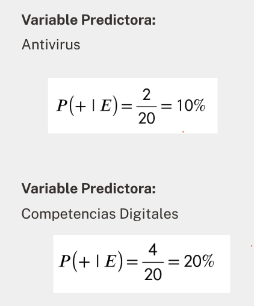

- **Unificamos la probabilidad:** Unificamos la probabilidad de ocurrencia en el caso de PHISHING.

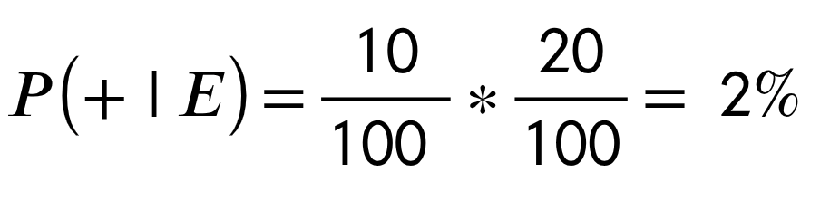

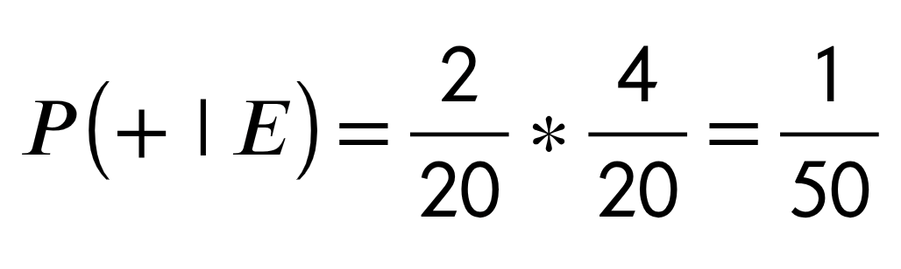

- **Realizamos lo propio para el otro conjunto de datos:** Respecto a los casos donde no se presenta el PHISHING, también realizamos el cálculo.

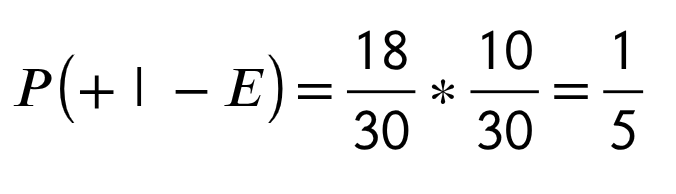

- **Realizamos los cálculos de probabilidad:** 

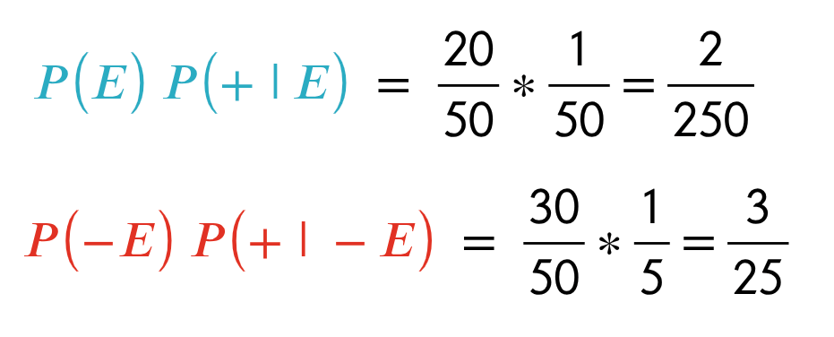

- **Realizamos el cálculo final:** 

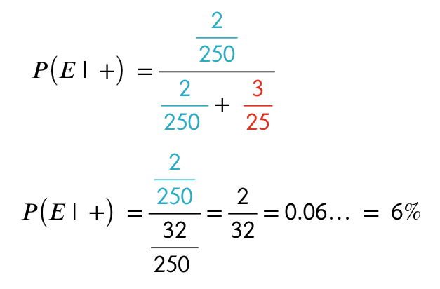

Al final, podemos concluir que:

```
Si los usuarios tienen el antivirus activado y tienen competencias digitales, hay un 6% de probabildad de que pasen por un ataque de phishing.
```