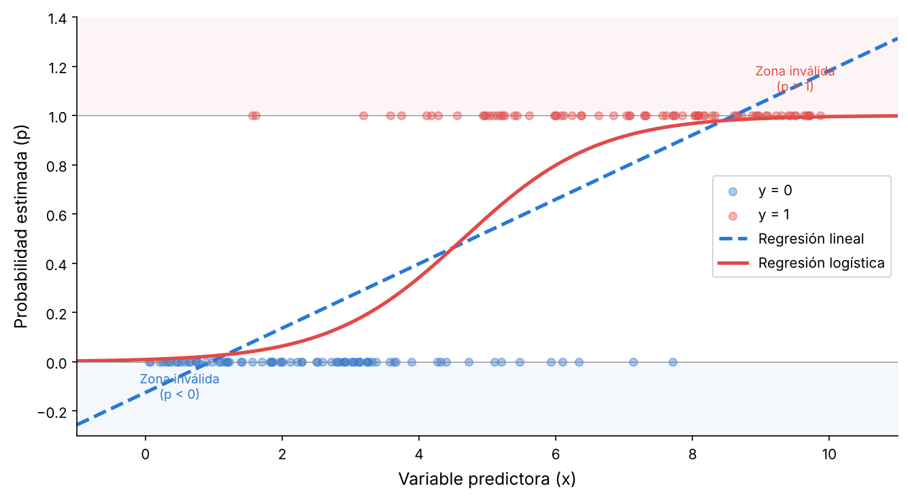
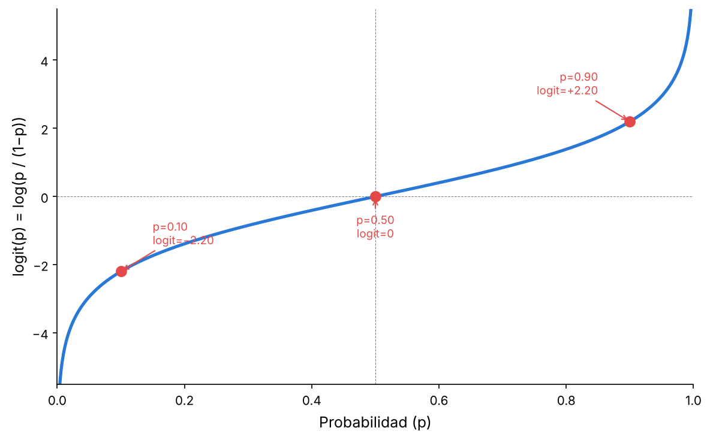
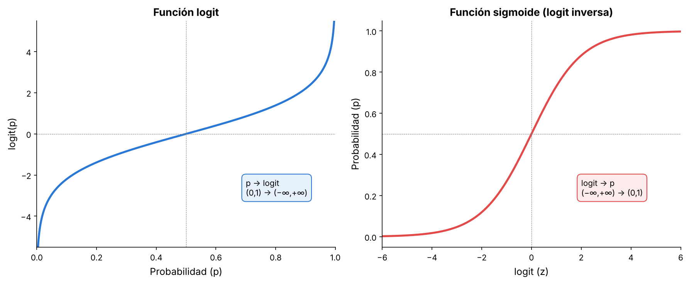
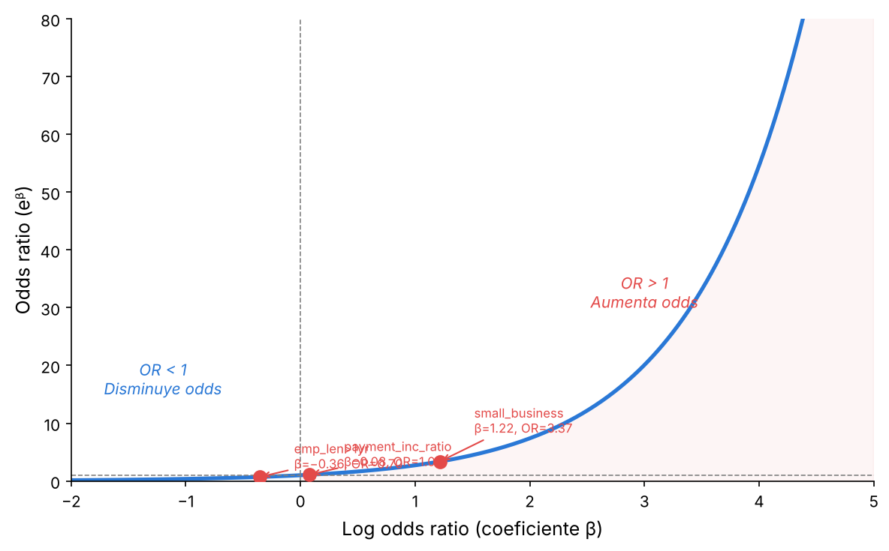
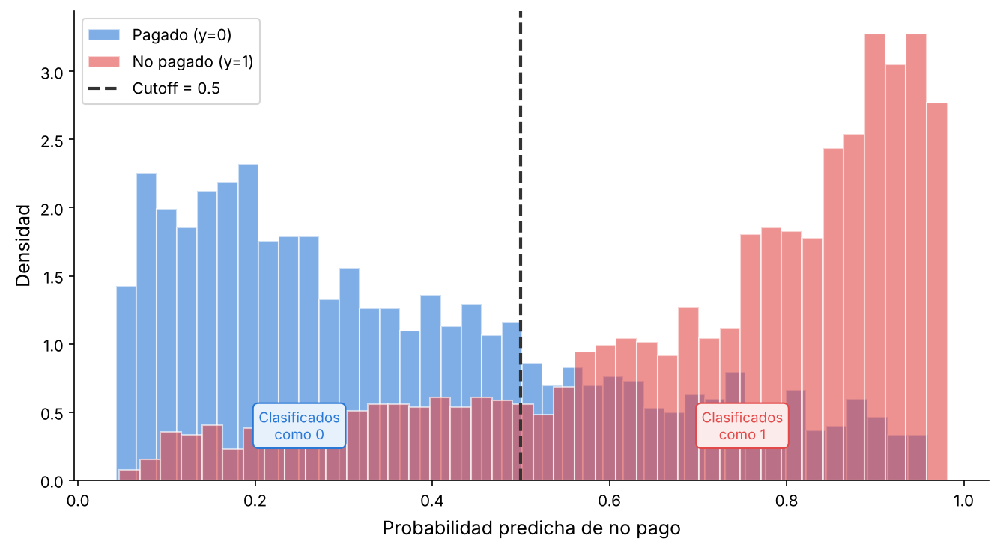
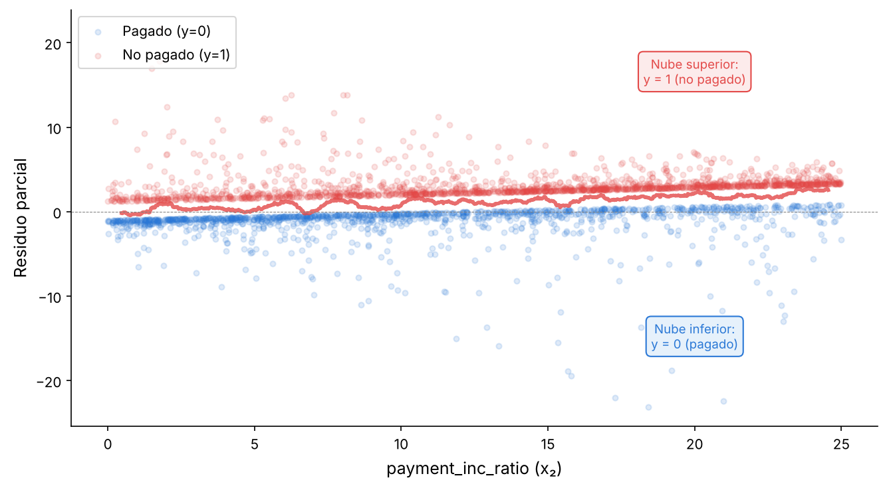
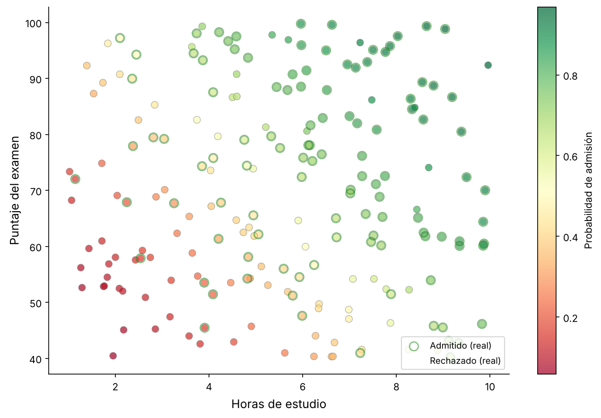

# 2.3 Regresión Logística

La regresión logística es un modelo que predice si algo va a pasar o no: dos opciones, sí o no, 1 o 0. Es análoga a la regresión lineal múltiple (véase el Capítulo 4 del libro), con la diferencia de que el resultado es binario. A diferencia de los algoritmos K-vecinos más cercanos y Naive Bayes, la regresión logística es un enfoque de modelado **estructurado**: asume una forma funcional fija desde el inicio y los datos solo sirven para estimar los coeficientes de esa ecuación. Una vez entrenado, el modelo no necesita los datos originales para predecir.

Debido a su rápida velocidad de cálculo y a que produce un modelo que se puede evaluar con unas pocas operaciones aritméticas, es uno de los métodos de clasificación más populares.

## Términos clave

- **Logit:** la función que mapea la probabilidad de pertenencia a una clase a un rango de ±∞ (en vez de 0 a 1). Sinónimo: log odds.
- **Odds:** la razón entre la probabilidad de "éxito" (1) y la de "no éxito" (0).
- **Log odds:** la respuesta en el modelo transformado (ahora lineal), que luego se mapea de vuelta a una probabilidad.
- **Función de respuesta logística:** la función inversa del logit, que convierte log odds de vuelta a probabilidades.
- **Regla de corte (cutoff):** cualquier registro con probabilidad mayor al corte se clasifica como 1.

## 2.3.1 ¿Por qué no sirve la regresión lineal?

Supongamos que queremos predecir si un préstamo se paga o no usando variables como el puntaje del prestatario y la relación cuota/ingreso. Podríamos intentar modelar la probabilidad *p* de impago como una función lineal:

$$
p = \beta_0 + \beta_1 x_1 + \beta_2 x_2 + \cdots + \beta_q x_q
$$

El problema es que esta ecuación puede dar **cualquier valor** entre −∞ y +∞. Nada impide que el resultado sea −0.3 o 1.5, pero una probabilidad solo puede estar entre 0 y 1.

La siguiente figura muestra este problema con datos simulados. La línea recta de la regresión lineal sale de los límites de la probabilidad:



*Figura 2.3.1. Comparación entre regresión lineal y regresión logística para datos binarios. La línea recta (azul) puede dar valores fuera de [0, 1], mientras que la curva logística (roja) siempre queda dentro del rango válido. Elaboración propia.*

## 2.3.2 Función de respuesta logística y logit

Para resolver el problema anterior se necesitan dos ingredientes: la **función de respuesta logística** y el **logit**. La idea es mapear una probabilidad (en escala de 0 a 1) a una escala más amplia que sea adecuada para el modelado lineal.

### Paso 1 — Modelo lineal ingenuo

Empezamos queriendo modelar la probabilidad como función lineal de los predictores:

$$
p = \beta_0 + \beta_1 x_1 + \beta_2 x_2 + \cdots + \beta_q x_q
$$

Pero como ya vimos, esto no garantiza que *p* quede entre 0 y 1.

### Paso 2 — Función de respuesta logística (logit inversa)

En vez de modelar *p* directamente, se aplica la **función logística** a los predictores:

$$
p = \frac{1}{1 + e^{-(\beta_0 + \beta_1 x_1 + \beta_2 x_2 + \cdots + \beta_q x_q)}}
$$

Esta transformación garantiza que 0 < *p* < 1, sin importar qué valores tomen los predictores. Pero ahora los coeficientes β están "atrapados" dentro del denominador exponencial, lo que hace difícil interpretar su efecto directamente.

### Paso 3 — Odds

Para sacar la exponencial del denominador, trabajamos con **odds** en vez de probabilidades. Los odds son la razón entre la probabilidad de que un evento ocurra y la de que no ocurra:

$$
\text{Odds}(Y = 1) = \frac{p}{1 - p}
$$

Los odds son familiares en las apuestas: si la probabilidad de ganar es 0.75, los odds son 0.75/0.25 = 3, es decir, "3 a 1 a favor".

### Paso 4 — De la función logística a los odds

Si partimos de la función logística y llamamos $z = \beta_0 + \beta_1 x_1 + \cdots$, podemos demostrar algebraicamente que:

$$
p = \frac{1}{1 + e^{-z}} \qquad \Rightarrow \qquad 1 - p = \frac{e^{-z}}{1 + e^{-z}}
$$

Dividiendo *p* entre (1 − *p*):

$$
\frac{p}{1-p} = \frac{\frac{1}{1+e^{-z}}}{\frac{e^{-z}}{1+e^{-z}}} = \frac{1}{e^{-z}} = e^{z}
$$

Por lo tanto:

$$
\text{Odds}(Y = 1) = e^{\beta_0 + \beta_1 x_1 + \beta_2 x_2 + \cdots + \beta_q x_q}
$$

### Paso 5 — Log odds (logit)

Finalmente, tomamos el logaritmo de ambos lados para obtener una expresión **lineal** en los predictores:

$$
\log(\text{Odds}(Y = 1)) = \beta_0 + \beta_1 x_1 + \beta_2 x_2 + \cdots + \beta_q x_q
$$

Esta es la función **logit**. El círculo de transformación está completo:

1. Empezamos con una probabilidad *p* (acotada entre 0 y 1)
2. La transformamos a odds (acotada entre 0 y +∞)
3. Tomamos el logaritmo para obtener log odds (libre entre −∞ y +∞)
4. Ahora podemos ajustar un modelo lineal en esa escala
5. Para predecir, recorremos el camino inverso: log odds → odds → probabilidad

## 2.3.3 Odds y log odds: ejemplo numérico

Para entender mejor, veamos un ejemplo concreto. Perú juega un partido de fútbol y estimamos que tiene un 75% de probabilidad de ganar:

| Concepto | Cálculo | Resultado |
|---|---|---|
| Probabilidad de ganar | *p* | 0.75 |
| Probabilidad de perder | 1 − *p* | 0.25 |
| Odds | *p* / (1 − *p*) | 3.0 |
| Log odds (logit) | log(3.0) | 1.099 |

**Interpretación de los odds:** "3 a 1 a favor". Por cada vez que pierde, gana 3 veces.

**Interpretación del logit:** 1.099 no tiene una interpretación intuitiva directa, pero es el valor que entra en la ecuación lineal del modelo. Su utilidad es que puede tomar cualquier valor real, haciéndolo compatible con un modelo lineal.

La siguiente tabla muestra cómo se relacionan las tres escalas para distintos valores:

| Probabilidad (*p*) | Odds (*p*/(1−*p*)) | Logit (log(odds)) | Interpretación |
|---|---|---|---|
| 0.01 | 0.01 | −4.60 | Muy improbable |
| 0.10 | 0.11 | −2.20 | Poco probable |
| 0.25 | 0.33 | −1.10 | Desfavorable |
| 0.50 | 1.00 | 0.00 | Neutral (50/50) |
| 0.75 | 3.00 | 1.10 | Favorable |
| 0.90 | 9.00 | 2.20 | Muy probable |
| 0.99 | 99.00 | 4.60 | Casi seguro |

Nótese la simetría: *p* = 0.25 y *p* = 0.75 tienen logits de signo opuesto (−1.10 y +1.10). Lo mismo ocurre con *p* = 0.10 y *p* = 0.90. Esto refleja que el logit es simétrico alrededor de *p* = 0.5, donde vale exactamente 0.

## 2.3.4 La curva logit

La función logit se puede graficar con *p* en el eje X y logit(*p*) en el eje Y. La curva resultante es una "S tumbada" (Figura 5-2 del libro):



*Figura 2.3.2. Gráfica de la función logit que mapea una probabilidad a una escala adecuada para un modelo lineal. Elaboración propia.*

Características de la curva:

- **En *p* = 0.5**, el logit vale exactamente 0. Este es el punto neutral.
- **Cuando *p* se acerca a 0**, el logit se dispara hacia −∞.
- **Cuando *p* se acerca a 1**, el logit se dispara hacia +∞.
- **La curva es simétrica** alrededor del punto (0.5, 0).
- **La pendiente es mayor en el centro** (cerca de *p* = 0.5) y se aplana en los extremos.

> **La analogía:** la probabilidad es una regla de 0 a 1 — tiene paredes. Un modelo lineal necesita una regla infinita. El logit es el "traductor": estira el rango (0, 1) hasta (−∞, +∞). Ajustas la recta en el terreno estirado y la función logística te devuelve al rango acotado.

La función inversa — la **función logística** o **sigmoide** — hace el camino contrario: toma un valor en (−∞, +∞) y lo devuelve a una probabilidad en (0, 1):

$$
p = \frac{1}{1 + e^{-\text{logit}}}
$$

La siguiente figura muestra ambas funciones lado a lado:



*Figura 2.3.3. La función logit (izquierda) y su inversa, la función sigmoide (derecha). Son la misma curva con los ejes intercambiados. Elaboración propia.*

## 2.3.5 Regresión logística y el GLM

La regresión logística es un caso particular de los **Modelos Lineales Generalizados** (GLM, por *Generalized Linear Model*). Un GLM tiene dos componentes principales:

1. **Familia (distribución de probabilidad):** describe el tipo de variable respuesta. En regresión logística, la familia es **binomial** porque el resultado es 0 o 1.
2. **Función de enlace (*link function*):** es la transformación que conecta la respuesta con los predictores. En regresión logística, la función de enlace es el **logit**.

Otras combinaciones de familia y enlace producen otros modelos:

| Modelo | Familia | Enlace | Uso típico |
|---|---|---|---|
| Regresión logística | Binomial | Logit | Clasificación binaria (sí/no) |
| Regresión de Poisson | Poisson | Log | Datos de conteo (visitas, accidentes) |
| Regresión gamma | Gamma | Inverso | Tiempos de espera, costos |
| Regresión lineal | Normal (Gaussiana) | Identidad | Respuesta continua |

En R, la función `glm` ajusta cualquier GLM. Para regresión logística se usa `family='binomial'`:

```r
logistic_model <- glm(outcome ~ payment_inc_ratio + purpose_ +
                      home_ + emp_len_ + borrower_score,
                      data=loan_data, family='binomial')
```

En Python, scikit-learn tiene `LogisticRegression` y statsmodels tiene `GLM`:

```python
# Con scikit-learn
from sklearn.linear_model import LogisticRegression
logit_reg = LogisticRegression(penalty='l2', C=1e42, solver='liblinear')
logit_reg.fit(X, y)

# Con statsmodels (más detallado, da p-values)
import statsmodels.api as sm
logit_reg_sm = sm.GLM(y_numbers, X.assign(const=1),
                       family=sm.families.Binomial())
logit_result = logit_reg_sm.fit()
logit_result.summary()
```

> **¿Por qué importa el GLM?** Saber que la regresión logística es un GLM te permite entender que muchas técnicas de la regresión lineal (selección de variables, splines, interacciones) se aplican igual aquí. La diferencia está en cómo se ajusta el modelo y cómo se interpretan los residuos.

## 2.3.6 Cómo se ajusta el modelo: MLE vs mínimos cuadrados

En la regresión lineal, los coeficientes se encuentran minimizando la suma de errores al cuadrado (método de **mínimos cuadrados**). Esto tiene una solución algebraica directa: se aplica una fórmula y se obtienen los coeficientes.

En la regresión logística **no existe** una solución cerrada. En vez de mínimos cuadrados, se usa la **estimación de máxima verosimilitud** (MLE, por *Maximum Likelihood Estimation*).

### ¿Qué es la máxima verosimilitud?

La idea es encontrar los coeficientes β que hacen **más probable** que se hayan observado los datos que tenemos. Es decir:

- Si un préstamo no se pagó (*y* = 1), el modelo debería asignarle una probabilidad alta de no pago.
- Si un préstamo sí se pagó (*y* = 0), el modelo debería asignarle una probabilidad baja de no pago.

El MLE busca los valores de β que maximizan la probabilidad conjunta de observar todos los datos:

$$
L(\beta) = \prod_{i=1}^{n} p_i^{y_i} (1 - p_i)^{1 - y_i}
$$

donde $p_i$ es la probabilidad predicha para el registro *i*.

### ¿Cómo se resuelve?

No hay una fórmula directa. Se usa un algoritmo iterativo llamado **Fisher's scoring** (o Newton-Raphson), que:

1. Empieza con valores iniciales para los coeficientes
2. Calcula en qué dirección moverse para mejorar la verosimilitud
3. Actualiza los coeficientes
4. Repite hasta que los cambios sean mínimos (convergencia)

### Deviance: la métrica del ajuste

En regresión lineal se usa el $R^2$ y el RMSE para evaluar el ajuste. En regresión logística se usa la **deviance**:

$$
\text{Deviance} = -2 \log \left( P_{\hat{\theta}}(X_1, X_2, \ldots, X_n) \right)
$$

Una deviance **más baja** indica un mejor ajuste. Se reportan dos valores:

| Tipo | Qué mide | Fórmula conceptual |
|---|---|---|
| **Null Deviance** | Ajuste del modelo sin predictores (solo el intercepto) | Modelo más simple posible |
| **Residual Deviance** | Ajuste del modelo con todos los predictores | Modelo completo |

La diferencia entre ambas indica cuánto mejora el modelo al incluir los predictores. En el ejemplo del libro:

- Null Deviance: 62,857 (con 45,341 grados de libertad)
- Residual Deviance: 57,515 (con 45,330 grados de libertad)

La reducción es de 5,342, lo que indica que los predictores aportan información, aunque el ajuste no es perfecto.

## 2.3.7 Variables dummy (variables indicadoras)

Cuando un predictor es **categórico** (como el propósito del préstamo: "tarjeta de crédito", "mejora del hogar", "pequeño negocio", etc.), no se puede meter directamente en la ecuación porque no es un número.

La solución es crear **variables dummy** (también llamadas variables indicadoras o *one-hot encoding*). Si la variable tiene *P* categorías, se crean *P* − 1 columnas binarias (0 o 1).

### Ejemplo: propósito del préstamo

La variable `purpose_` tiene 7 categorías. Se elige una como **categoría de referencia** (en R, por defecto es la primera en orden alfabético: `credit_card`). Las demás se convierten en columnas:

| Préstamo | purpose_ | debt_consolidation | home_improvement | major_purchase | medical | other | small_business |
|---|---|---|---|---|---|---|---|
| 1 | credit_card | 0 | 0 | 0 | 0 | 0 | 0 |
| 2 | small_business | 0 | 0 | 0 | 0 | 0 | 1 |
| 3 | home_improvement | 0 | 1 | 0 | 0 | 0 | 0 |
| 4 | debt_consolidation | 1 | 0 | 0 | 0 | 0 | 0 |

**¿Por qué *P* − 1 y no *P* columnas?** Porque si todas las demás son 0, ya se sabe que es la categoría de referencia. Usar *P* columnas crearía **colinealidad perfecta** (una columna sería combinación lineal de las demás) y el modelo no podría estimarse.

En Python con pandas:

```python
predictors = ['payment_inc_ratio', 'purpose_', 'home_', 'emp_len_',
              'borrower_score']
X = pd.get_dummies(loan_data[predictors], prefix='', prefix_sep='',
                   drop_first=True)
```

El argumento `drop_first=True` elimina automáticamente la categoría de referencia.

> **Nota:** en scikit-learn las clases se derivan de los valores únicos de *y* (`paid off` y `default`), y se ordenan alfabéticamente. Como `default` viene antes que `paid off`, los coeficientes de scikit-learn están invertidos respecto a R. Es importante saber qué clase el modelo trata como "1".

## 2.3.8 Interpretación de coeficientes: el Odds Ratio

Una ventaja de la regresión logística es que sus coeficientes se pueden interpretar fácilmente usando el **odds ratio** (razón de odds).

### ¿Qué es el odds ratio?

Para una variable binaria *X* (0 o 1), el odds ratio compara los odds cuando *X* = 1 con los odds cuando *X* = 0:

$$
\text{Odds Ratio} = \frac{\text{Odds}(Y=1 \mid X=1)}{\text{Odds}(Y=1 \mid X=0)} = e^{\beta}
$$

donde β es el coeficiente de la variable *X* en el modelo.

### Interpretación

- **OR > 1:** la variable **aumenta** los odds del evento. Ejemplo: si OR = 3.4, los odds son 3.4 veces mayores cuando *X* = 1.
- **OR = 1:** la variable **no tiene efecto** (β = 0).
- **OR < 1:** la variable **disminuye** los odds del evento. Ejemplo: si OR = 0.01, los odds se reducen 100 veces.

### Ejemplo con los datos del libro

Del modelo ajustado con los datos de préstamos:

| Variable | Coeficiente (β) | Odds Ratio ($e^{\beta}$) | Interpretación |
|---|---|---|---|
| `purpose_small_business` | 1.2153 | 3.37 | Préstamos para pequeño negocio tienen **3.4×** más odds de impago que los de tarjeta de crédito |
| `borrower_score` | −4.6126 | 0.01 | Los mejores prestatarios tienen **100×** menos riesgo que los peores |
| `payment_inc_ratio` | 0.0797 | 1.08 | Por cada unidad más de cuota/ingreso, los odds de impago suben **8%** |
| `home_OWN` | 0.0483 | 1.05 | Ser propietario casi no cambia los odds (OR ≈ 1) |



*Figura 2.3.4. Relación entre el log odds ratio (coeficiente β) y el odds ratio ($e^{\beta}$). Cuando β > 0, el OR > 1 y la variable aumenta los odds. Elaboración propia.*

> **Para variables numéricas:** el odds ratio se interpreta como el cambio multiplicativo en los odds por cada unidad de aumento en la variable. Por ejemplo, si `payment_inc_ratio` sube de 5 a 6, los odds de impago se multiplican por $e^{0.0797} \approx 1.08$, es decir, suben un 8%.

## 2.3.9 Valores predichos y cutoff

El modelo produce una **probabilidad predicha** para cada registro. Para convertir esa probabilidad en una clasificación (0 o 1), se necesita un **punto de corte** (cutoff o threshold).

### ¿Cómo funciona?

1. El modelo calcula la probabilidad de que el registro pertenezca a la clase 1
2. Si la probabilidad es **mayor que el cutoff**, se clasifica como 1
3. Si es **menor o igual**, se clasifica como 0

El cutoff más común es **0.5**, pero no siempre es el mejor:

- Si la clase positiva es **rara** (fraude, enfermedad), un cutoff de 0.5 puede no detectar casi ningún caso positivo. En esa situación conviene bajar el cutoff (por ejemplo, a 0.3).
- Si el costo de un **falso negativo** es muy alto (no detectar un cáncer), también conviene bajar el cutoff.

En Python:

```python
# Probabilidades predichas
prob = logit_reg.predict_proba(X)[:, 1]

# Con cutoff = 0.5 (por defecto)
pred_05 = (prob >= 0.5).astype(int)

# Con cutoff = 0.3
pred_03 = (prob >= 0.3).astype(int)
```

La siguiente figura muestra la distribución de las probabilidades predichas para cada clase:



*Figura 2.3.5. Distribución de las probabilidades predichas por el modelo para cada clase. La línea vertical indica el cutoff de 0.5. Elaboración propia.*

## 2.3.10 Evaluación del modelo: p-values y z-values

Cuando se ajusta una regresión logística con `statsmodels` (o con `glm` en R), el resumen incluye para cada coeficiente:

- **Estimate:** el valor del coeficiente β
- **Std. Error:** el error estándar del coeficiente
- **z-value:** el estadístico z = β / Std. Error
- **Pr(>|z|):** el p-value asociado

| Variable | β | Std. Error | z-value | p-value | Significancia |
|---|---|---|---|---|---|
| (Intercept) | 1.6381 | 0.0737 | 22.22 | < 2e-16 | *** |
| payment_inc_ratio | 0.0797 | 0.0025 | 32.06 | < 2e-16 | *** |
| purpose_small_business | 1.2153 | 0.0633 | 19.19 | < 2e-16 | *** |
| borrower_score | −4.6126 | 0.0836 | −55.20 | < 2e-16 | *** |
| home_OWN | 0.0483 | 0.0380 | 1.27 | 0.204 | |

**Cómo leer la tabla:**

- Un **z-value grande** (en valor absoluto) y un **p-value pequeño** (< 0.05) indican que la variable es estadísticamente significativa.
- Los asteriscos indican el nivel de significancia: `***` para p < 0.001, `**` para p < 0.01, `*` para p < 0.05.
- En el ejemplo, `home_OWN` tiene un p-value de 0.204, lo que significa que ser propietario **no** es un predictor significativo de impago.
- `borrower_score` tiene el z-value más grande (−55.20), confirmando que es la variable más importante.

> **Precaución:** el p-value en regresión logística debe verse más como un indicador de **importancia relativa** de la variable que como una prueba de significancia estadística formal. Para evaluar el rendimiento del modelo se usan métricas de clasificación (precisión, recall, AUC), que se explican en la sección 2.4.

## 2.3.11 Residuos parciales

En regresión lineal, los residuos (la diferencia entre el valor real y el predicho) se usan para verificar los supuestos del modelo. En regresión logística, los residuos tienen un comportamiento diferente.

### ¿Por qué son distintos?

El valor real es 0 o 1 (binario), pero la predicción es un logit (un valor continuo). Como el valor real corresponde a un logit de −∞ (para 0) o +∞ (para 1), los residuos (valor real − predicción) siempre serán positivos o negativos, y **nunca serán cero**. Esto produce un patrón muy característico:



*Figura 2.3.6. Residuos parciales de la regresión logística para la variable `payment_inc_ratio`. Se observan dos nubes de puntos. La nube superior corresponde a los préstamos no pagados (y = 1) y la inferior a los pagados (y = 0). Elaboración propia.*

### Las dos nubes

La figura muestra dos nubes de puntos claramente separadas:

- **Nube superior:** corresponde a los registros con *y* = 1 (préstamos no pagados). Como el modelo predice un logit finito pero el valor real es "infinito positivo", el residuo es siempre positivo.
- **Nube inferior:** corresponde a los registros con *y* = 0 (préstamos pagados). El residuo es siempre negativo.

La **línea roja** muestra el ajuste suavizado. Si esta línea es aproximadamente recta, el modelo logístico captura bien la relación. Si se curva mucho, podría ser necesario incluir un término no lineal (como un spline).

Los residuos parciales en regresión logística son menos informativos que en regresión lineal, pero siguen siendo útiles para detectar relaciones no lineales y registros influyentes.

## Ventajas y limitaciones

| Ventajas | Limitaciones |
|---|---|
| Es rápido de calcular y de aplicar a nuevos datos. | Asume una relación lineal entre los predictores y el logit. |
| Los coeficientes se interpretan fácilmente como odds ratios. | No captura relaciones complejas sin transformaciones adicionales. |
| Produce probabilidades, no solo etiquetas. | Puede ser inestable con variables altamente correlacionadas (multicolinealidad). |
| Funciona bien con datos mixtos (numéricos y categóricos). | Es sensible a valores atípicos en los predictores. |
| Se integra en el marco de los GLM, lo que permite usar herramientas conocidas. | Requiere suficientes registros por cada variable (regla general: ≥ 10 eventos por predictor). |

## 2.3.12 Ejemplo completo en Python

A continuación se presenta un ejemplo completo usando datos simulados de admisión universitaria. El objetivo es predecir si un estudiante es admitido (1) o rechazado (0) según su puntaje en un examen y sus horas de estudio.

```python
import numpy as np
import pandas as pd
import matplotlib.pyplot as plt
from sklearn.linear_model import LogisticRegression
from sklearn.metrics import confusion_matrix, classification_report

# ── 1. Generar datos simulados ──
np.random.seed(123)
n = 200
horas_estudio = np.random.uniform(1, 10, n)
puntaje_examen = np.random.uniform(40, 100, n)

# La probabilidad de admisión depende de ambas variables
z = -6 + 0.5 * horas_estudio + 0.05 * puntaje_examen
prob_real = 1 / (1 + np.exp(-z))
admitido = np.random.binomial(1, prob_real)

df = pd.DataFrame({
    'horas_estudio': horas_estudio,
    'puntaje_examen': puntaje_examen,
    'admitido': admitido
})

print(f"Admitidos: {admitido.sum()} / {n}")
print(df.head())

# ── 2. Ajustar el modelo ──
X = df[['horas_estudio', 'puntaje_examen']]
y = df['admitido']

modelo = LogisticRegression(penalty=None, solver='lbfgs')
modelo.fit(X, y)

print(f"\nIntercepto: {modelo.intercept_[0]:.4f}")
print(f"Coeficientes:")
for nombre, coef in zip(X.columns, modelo.coef_[0]):
    print(f"  {nombre}: {coef:.4f} (OR = {np.exp(coef):.4f})")

# ── 3. Predicciones ──
prob_pred = modelo.predict_proba(X)[:, 1]
pred = modelo.predict(X)

# ── 4. Matriz de confusión ──
cm = confusion_matrix(y, pred)
print(f"\nMatriz de confusión:")
print(cm)
print(f"\nReporte de clasificación:")
print(classification_report(y, pred, target_names=['Rechazado', 'Admitido']))

# ── 5. Gráfica de las probabilidades predichas ──
fig, ax = plt.subplots(figsize=(9, 6))
scatter = ax.scatter(df['horas_estudio'], df['puntaje_examen'],
                     c=prob_pred, cmap='RdYlGn', edgecolors='gray',
                     alpha=0.7, s=50)
plt.colorbar(scatter, label='Probabilidad de admisión')
ax.set_xlabel('Horas de estudio', fontsize=12)
ax.set_ylabel('Puntaje del examen', fontsize=12)
ax.spines['top'].set_visible(False)
ax.spines['right'].set_visible(False)
plt.tight_layout()
plt.savefig('img/2.3.7_ejemplo_admision.png', dpi=150, bbox_inches='tight')
plt.close()
print("\n✓ Figura del ejemplo guardada")
```



*Figura 2.3.7. Modelo de regresión logística para predecir admisión universitaria. El color indica la probabilidad predicha: verde para alta probabilidad de admisión y rojo para baja. Elaboración propia.*

### Interpretación del ejemplo

- **Intercepto negativo** (≈ −6): cuando las horas de estudio y el puntaje son cero, la probabilidad de admisión es prácticamente nula.
- **Coeficiente de horas_estudio** (≈ 0.5): por cada hora adicional de estudio, los odds de admisión se multiplican por $e^{0.5} \approx 1.65$, es decir, suben un 65%.
- **Coeficiente de puntaje_examen** (≈ 0.05): por cada punto adicional en el examen, los odds de admisión se multiplican por $e^{0.05} \approx 1.05$, un aumento del 5%.

## Ideas clave

- La regresión logística es como la regresión lineal, pero para una variable binaria.
- Se necesitan varias transformaciones (probabilidad → odds → log odds) para convertir el problema en un modelo lineal. El log odds ratio es la variable respuesta.
- El modelo se ajusta por un proceso iterativo (MLE), no por mínimos cuadrados.
- Los coeficientes se interpretan como odds ratios: $e^{\beta}$ indica cuánto cambian los odds por cada unidad de la variable.
- La regresión logística es rápida, interpretable y produce un modelo que se puede aplicar a nuevos datos con unas pocas operaciones aritméticas.
- Es un caso particular del GLM (familia binomial, enlace logit).

## Lecturas recomendadas

- *Applied Logistic Regression*, 3ª ed., de David Hosmer, Stanley Lemeshow y Rodney Sturdivant (Wiley, 2013). Es la referencia estándar.
- *Logistic Regression Models* de Joseph Hilbe (Chapman & Hall, 2017). Muy completo.
- *Practical Guide to Logistic Regression* de Joseph Hilbe (Chapman & Hall, 2015). Más compacto.
- *The Elements of Statistical Learning*, 2ª ed., de Hastie, Tibshirani y Friedman (Springer, 2009), y su versión más corta *An Introduction to Statistical Learning* de James, Witten, Hastie y Tibshirani (Springer, 2013), tienen secciones sobre regresión logística.
- *Data Mining for Business Analytics* de Galit Shmueli, Peter Bruce, Nitin Patel, Peter Gedeck, Inbal Yahav y Kenneth Lichtendahl (Wiley, 2007–2020) tiene un capítulo completo.
