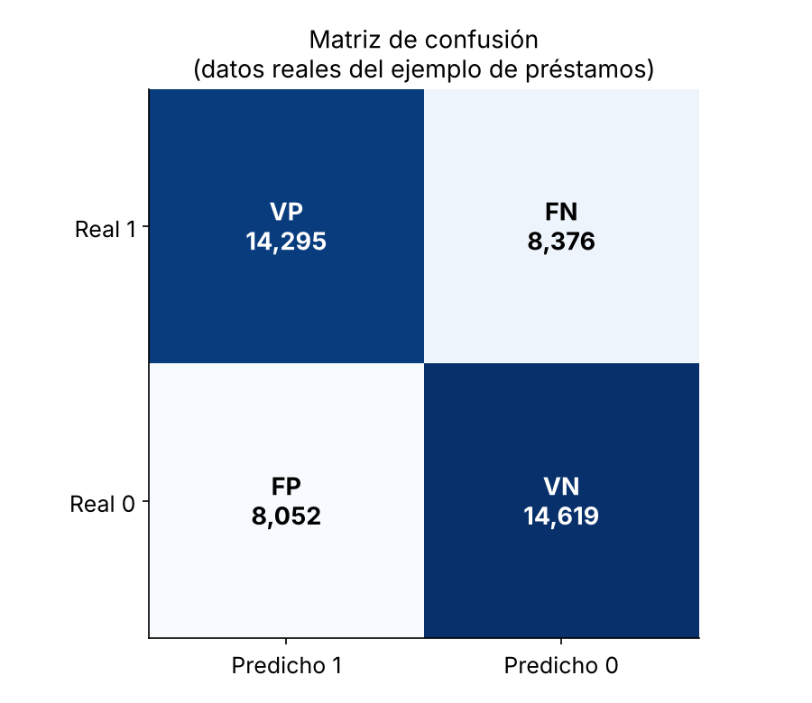
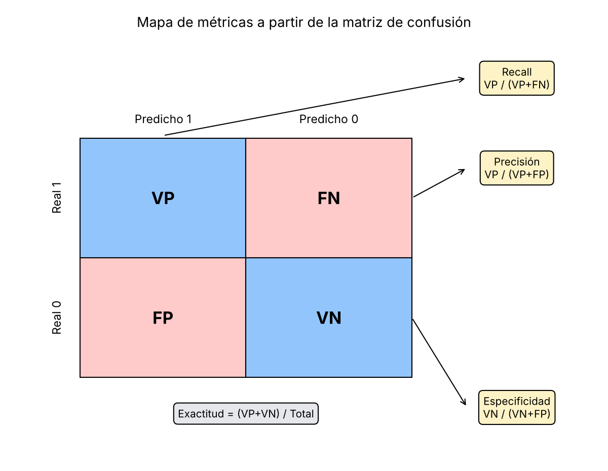
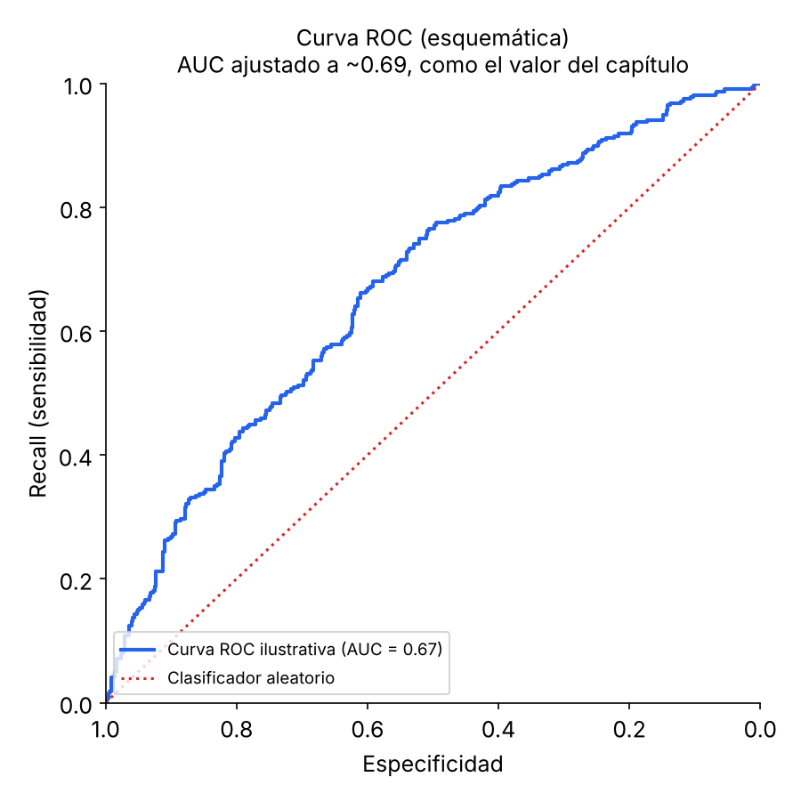
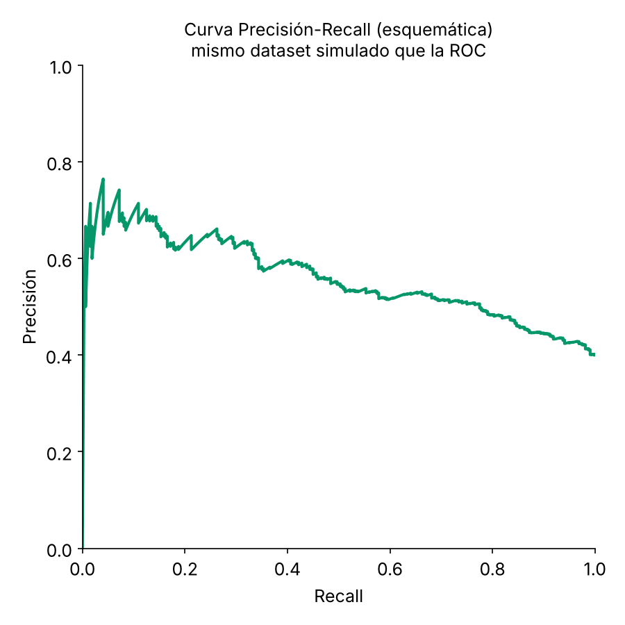
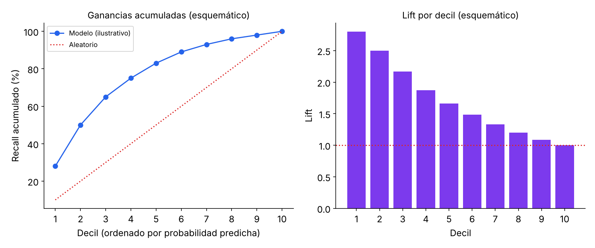

# 2.4 Evaluación de Modelos de Clasificación

Entrenar un modelo es solo la mitad del trabajo: falta saber si clasifica bien. Medirlo no es tan simple como contar aciertos, porque el valor de un modelo depende de qué tipo de error resulta más costoso en el problema concreto. En esta sección se construye la matriz de confusión (2.4.2), de ahí salen las métricas que dependen de un único punto de corte (2.4.3), que fallan en un caso muy común, el de la clase rara (2.4.4). Eso lleva a herramientas que ya no dependen de un solo corte: la curva ROC y el AUC (2.4.5) y, para el caso desbalanceado, la curva de precisión-recall y el lift (2.4.6). Se cierra con lo que el capítulo original no cubre por enfocarse en dos clases (2.4.7).

## Términos clave

- **Matriz de confusión:** tabla que cruza lo que el modelo predijo con lo que realmente ocurrió.
- **Exactitud (accuracy):** porcentaje total de predicciones correctas.
- **Precisión:** de todo lo que el modelo marcó como positivo, la proporción que realmente lo era.
- **Recall (sensibilidad):** de todos los positivos reales, la proporción que el modelo detectó.
- **Especificidad:** de todos los negativos reales, la proporción que el modelo identificó correctamente.
- **Curva ROC:** gráfico de recall contra especificidad para todos los puntos de corte posibles.
- **AUC:** área bajo la curva ROC; resume la capacidad del modelo para distinguir las dos clases.
- **Lift:** cuánto mejor que el azar le va al modelo al elegir los casos de mayor probabilidad.

## 2.4.1 Por qué se evalúa en varias etapas

Al entrenar varios modelos y compararlos, es común dividir los datos en tandas con roles distintos:

| Etapa | Nombre habitual | Para qué sirve |
|---|---|---|
| Ajuste | *Training set* | Estimar los parámetros del modelo |
| Comparación | *Validation set* | Comparar modelos entre sí y afinar hiperparámetros |
| Evaluación final | *Test set* / *Holdout* | Estimar el desempeño con datos que el modelo nunca vio, ni siquiera indirectamente |

Los nombres varían según la disciplina (algunos usan "validación" y "prueba" de forma intercambiable), pero la razón de fondo es siempre la misma: si el modelo se evalúa con datos que ya influyeron, aunque sea indirectamente, en su ajuste o en la elección de hiperparámetros, el resultado sale optimista. Por eso, cuando hay datos suficientes, conviene reservar una tercera muestra que no se toque hasta el final del proceso.

Con eso resuelto, queda la pregunta central de esta sección: ¿qué significa que un modelo sea "bueno"? La respuesta corta, que se va a repetir de distintas formas en cada sección, es que depende de qué tipo de error te sale más caro en tu problema concreto. No hay una sola métrica que sirva para todo.

## 2.4.2 La matriz de confusión

Todas las métricas de clasificación binaria (0/1) se derivan de esta tabla, que cruza lo que el modelo predijo contra lo que realmente pasó. Por convención, Y = 1 es el evento de interés (fraude, impago, enfermedad) e Y = 0 es el caso "normal" (transacción legítima, préstamo pagado, persona sana).

|  | Predicho 1 | Predicho 0 |
|---|---|---|
| **Real 1** | Verdadero Positivo (VP) | Falso Negativo (FN) |
| **Real 0** | Falso Positivo (FP) | Verdadero Negativo (VN) |

Cada celda tiene un significado práctico distinto:

- **Verdadero Positivo (VP):** el modelo detectó correctamente un caso positivo. Ejemplo: detectó un fraude real.
- **Verdadero Negativo (VN):** el modelo descartó correctamente un caso negativo. Ejemplo: dijo "no es fraude" y en efecto no lo era.
- **Falso Positivo (FP), error tipo I:** el modelo dijo "positivo" y era negativo. Es la falsa alarma. Ejemplo: marcar como fraudulenta una compra legítima, lo que genera molestia al cliente.
- **Falso Negativo (FN), error tipo II:** el modelo dijo "negativo" y era positivo. Es el caso que se escapó. Ejemplo: no detectar un fraude real, lo que genera una pérdida de dinero directa.

Este es el punto más importante de toda la sección: FP y FN casi nunca cuestan lo mismo, y esa asimetría es la que en la práctica decide qué métrica te conviene mirar más de cerca. En detección de cáncer, un FN (no detectar un tumor real) suele ser mucho más grave que un FP (una alarma que después se descarta con más pruebas). En un filtro de spam ocurre al revés: un FP (mandar un correo importante a la carpeta de spam) puede doler más que un FN (dejar pasar algo de spam, que es solo una molestia menor).

### Ejemplo de cálculo con los datos reales del capítulo

Usando el modelo `logistic_gam` entrenado sobre datos de préstamos:

|  | Predicho impago | Predicho pagado |
|---|---|---|
| **Real impago** | 14,295 (VP) | 8,376 (FN) |
| **Real pagado** | 8,052 (FP) | 14,619 (VN) |



**Código (Python):**
```python
pred = logit_reg.predict(X)
pred_y = logit_reg.predict(X) == 'default'
true_y = y == 'default'

true_pos  = true_y & pred_y
true_neg  = ~true_y & ~pred_y
false_pos = ~true_y & pred_y
false_neg = true_y & ~pred_y

conf_mat = pd.DataFrame(
    [[np.sum(true_pos), np.sum(false_neg)],
     [np.sum(false_pos), np.sum(true_neg)]],
    index=['Y = default', 'Y = paid off'],
    columns=['Yhat = default', 'Yhat = paid off'])
conf_mat
```

De 22,671 préstamos que en realidad terminaron en impago (14,295 + 8,376), el modelo detectó correctamente 14,295 y dejó pasar 8,376. De 22,671 préstamos pagados, identificó bien 14,619 pero marcó erróneamente 8,052 como riesgo de impago.

Detalle a tener en cuenta al comparar matrices de distintas fuentes: no existe una convención universal sobre si las filas son lo real y las columnas lo predicho, o al revés. El popular paquete `caret` de R, por ejemplo, invierte el orden habitual respecto al usado aquí. Conviene siempre revisar las etiquetas de los ejes antes de interpretar una matriz ajena.

## 2.4.3 Métricas de un punto de corte fijo

La mayoría de los algoritmos no devuelven directamente "0" o "1", sino una probabilidad estimada de pertenecer a la clase 1. El punto de corte (*cutoff* o *threshold*) por defecto suele ser 0.50: si la probabilidad supera 0.5, se clasifica como 1; si no, como 0. Todas las métricas de esta sección se calculan para un corte específico, y cambian si se mueve ese corte.

El corte no está grabado en piedra y conviene ajustarlo según el problema:

- Bajarlo (por ejemplo a 0.3) hace que el modelo clasifique más casos como "1": sube el recall, baja la precisión, porque aparecen más falsos positivos.
- Subirlo (por ejemplo a 0.7) hace que el modelo sea más exigente para decir "1": sube la precisión, baja el recall, porque aparecen más falsos negativos.

Un corte alternativo común es usar la prevalencia (la proporción real de 1s en los datos) en lugar de 0.5, particularmente útil cuando las clases están desbalanceadas (ver 2.4.4).

El diagrama siguiente resume de dónde sale cada fórmula que viene a continuación:



### Exactitud (Accuracy)

```
Exactitud = (VP + VN) / (VP + VN + FP + FN)
```

Es el porcentaje total de predicciones correctas: la métrica más intuitiva, y también la más fácil de malinterpretar, como se ve en 2.4.4.

### Precisión (Precision)

Responde: de todo lo que el modelo marcó como positivo, ¿cuánto acertó?

```
Precisión = VP / (VP + FP)
```

Una precisión alta significa pocas falsas alarmas. Importa cuando el costo de un falso positivo es alto: acusar a alguien injustamente, bloquear una transacción legítima de un cliente.

### Recall (Sensibilidad)

Responde: de todos los positivos reales, ¿cuántos detectó el modelo?

```
Recall = VP / (VP + FN)
```

Un recall alto significa que pocos casos positivos se escapan. Importa cuando el costo de un falso negativo es alto: no detectar una enfermedad, no atrapar el fraude real. El término *sensitivity* se usa más en bioestadística y medicina; *recall*, en aprendizaje automático, pero ambos son la misma fórmula.

### Especificidad (Specificity)

Responde: de todos los negativos reales, ¿cuántos identificó correctamente el modelo?

```
Especificidad = VN / (VN + FP)
```

**Código (Python):**
```python
conf_mat = confusion_matrix(y, logit_reg.predict(X))
print('Precision',   conf_mat[0, 0] / sum(conf_mat[:, 0]))
print('Recall',      conf_mat[0, 0] / sum(conf_mat[0, :]))
print('Specificity', conf_mat[1, 1] / sum(conf_mat[1, :]))

precision_recall_fscore_support(y, logit_reg.predict(X),
                                 labels=['default', 'paid off'])
```

`scikit-learn` incluye el método `precision_recall_fscore_support`, que calcula precisión y recall/especificidad de una sola vez.

### La tensión entre precisión y recall

Precisión y recall tienden a moverse en direcciones opuestas cuando se cambia el punto de corte: capturar más positivos reales (recall más alto) casi siempre implica aceptar más falsas alarmas (precisión más baja). No existe un modelo que maximice ambas a la vez sin límite alguno; hay que decidir, según el problema, cuál de las dos pesa más.

### F1-score (no mencionado en el capítulo original)

Cuando hace falta un solo número que resuma ese balance, por ejemplo para comparar modelos de forma automática sin mirar dos métricas por separado, se usa la media armónica de precisión y recall:

```
F1 = 2 x (Precisión x Recall) / (Precisión + Recall)
```

La media armónica, a diferencia de un promedio simple, castiga con fuerza cuando una de las dos métricas es baja, aunque la otra sea alta. Si un modelo tiene precisión de 0.9 pero recall de 0.1, un promedio simple daría 0.5 (parece aceptable), mientras que el F1 da 0.18 (revela que el modelo es malo en la práctica). Por eso se usa tanto en la industria: junto con la matriz de confusión completa, no en su reemplazo.

## 2.4.4 El problema de la clase rara

Todas las métricas anteriores se vuelven especialmente relevantes, o especialmente engañosas, cuando una clase es mucho menos frecuente que la otra: fraude, fuga de clientes, enfermedades poco comunes, clics en publicidad. La clase minoritaria, que casi siempre es la que más importa, suele designarse como 1.

**Ejemplo clásico:** si solo el 0.1% de los visitantes de una tienda online termina comprando, un modelo que prediga "nadie compra nunca" tendría 99.9% de exactitud… y sería completamente inútil, porque no identifica ni a un solo comprador real. Este es el motivo exacto por el cual la exactitud sola nunca debe usarse como criterio de éxito cuando las clases están desbalanceadas: precisión, recall y F1, calculados sobre la clase minoritaria, cuentan una historia muy distinta y mucho más honesta.

**Cómo se maneja esto en la práctica** (complemento que el capítulo no desarrolla):

- **Sobremuestreo** de la clase minoritaria, o técnicas como **SMOTE**, que genera ejemplos sintéticos interpolando entre casos reales de la clase rara.
- **Submuestreo** de la clase mayoritaria, descartando parte de sus casos para equilibrar la proporción.
- **Ponderación de clases** (*class weights*): penalizar más fuerte, durante el entrenamiento, los errores cometidos sobre la clase minoritaria.
- **Ajustar el punto de corte** en lugar de tocar los datos: suele ser la opción más simple, más barata y la primera que conviene probar antes de complicar el pipeline con remuestreo.

## 2.4.5 Métricas que evalúan todos los cortes: ROC y AUC

Las métricas de 2.4.3 dependen de haber fijado un único punto de corte. La curva **ROC** (*Receiver Operating Characteristic*) evita esa dependencia recorriendo todos los cortes posibles a la vez y graficando, para cada uno, el recall contra la especificidad.

**Procedimiento para construirla:**
1. Ordenar los registros por probabilidad predicha de ser un 1, de mayor a menor.
2. Calcular recall y especificidad acumulados a medida que se recorre esa lista. Esto equivale a probar, uno por uno, todos los cortes posibles, sin tener que fijar ninguno de antemano.

> **Nota sobre el gráfico siguiente:** el capítulo reporta un AUC de 0.6926 para el modelo de préstamos, pero no publica el conjunto de datos completo (las probabilidades individuales de cada registro), así que no es posible reconstruir la curva ROC exacta de ese modelo específico. La curva de abajo es una simulación aparte, construida para alcanzar un AUC cercano (~0.67-0.69) solo con el fin de mostrar la forma típica de una curva ROC de esa calidad; no es la curva real del ejemplo de préstamos del capítulo.



**Código (Python):**
```python
fpr, tpr, thresholds = roc_curve(y, logit_reg.predict_proba(X)[:,0],
                                  pos_label='default')
roc_df = pd.DataFrame({'recall': tpr, 'specificity': 1 - fpr})
ax = roc_df.plot(x='specificity', y='recall', figsize=(4, 4), legend=False)
ax.set_ylim(0, 1)
ax.set_xlim(1, 0)
ax.plot((1, 0), (0, 1))
ax.set_xlabel('specificity')
ax.set_ylabel('recall')
```

**Cómo leerla:** la diagonal punteada representa un clasificador que no hace nada mejor que adivinar al azar. Cuanto más se acerque la curva a la esquina superior izquierda, mejor el clasificador: logra alto recall con alta especificidad simultáneamente. La curva también sirve para elegir a ojo un punto de corte concreto, según cuánta especificidad se está dispuesto a sacrificar a cambio de más recall.

*Dato histórico del capítulo original: la curva ROC se usó por primera vez durante la Segunda Guerra Mundial, para evaluar qué tan bien distinguían los operadores de radar las señales reales de aviones enemigos del ruido de fondo.*

### AUC: el área bajo la curva

El **AUC** (*Area Under the Curve*) condensa la curva ROC completa en un único número: la probabilidad de que el modelo asigne una probabilidad más alta a un caso positivo elegido al azar que a uno negativo elegido al azar.

| Valor de AUC | Interpretación |
|---|---|
| 1.0 | Clasificador perfecto |
| 0.9 – 1.0 | Excelente |
| 0.8 – 0.9 | Bueno |
| 0.7 – 0.8 | Aceptable |
| 0.5 – 0.7 | Débil |
| 0.5 | Equivalente a adivinar al azar |
| < 0.5 | Peor que el azar (revisar si las etiquetas están invertidas) |

**Código (Python):**
```python
print(np.sum(roc_df.recall[:-1] * np.diff(1 - roc_df.specificity)))  # ~0.6926 en el ejemplo del capítulo
print(roc_auc_score([1 if yi == 'default' else 0 for yi in y],
                     logit_reg.predict_proba(X)[:, 0]))
```

En el ejemplo del capítulo, el modelo de préstamos obtiene un AUC de aproximadamente 0.69: mejor que el azar, pero un clasificador relativamente débil.

**Dos advertencias que el capítulo original menciona solo de pasada, o no menciona:**

Primero, el término "tasa de falsos positivos" (FPR) se define de forma inconsistente entre disciplinas, y a veces hasta entre distintas herramientas de software. La definición estándar usada en ROC es FPR = 1 − especificidad, pero en contextos como la detección de intrusiones en redes a veces se usa el término para describir la proporción de alertas positivas que en realidad son negativos reales, lo cual es 1 − precisión, una cosa distinta. Conviene siempre revisar la fórmula exacta que usa cada herramienta antes de comparar números entre sí.

Segundo, y esto no está en el texto original: el AUC promedia el desempeño del modelo sobre todos los posibles cortes, incluidos muchos que nunca se usarían en producción. Dos modelos pueden tener exactamente el mismo AUC y comportarse de forma muy distinta justo en la región de corte que sí interesa en la práctica, por ejemplo el 5% de casos con mayor probabilidad predicha. Por eso, en problemas de clase rara, conviene complementar el AUC con herramientas que se enfoquen solo en esa región: la curva de precisión-recall y el lift, que son el tema de 2.4.6.

## 2.4.6 Cuando las clases están muy desbalanceadas: curva PR y lift

### Curva de Precisión-Recall (PR)

Se construye igual que la curva ROC (ordenando los registros por probabilidad predicha, de menos a más probable en este caso, y calculando estadísticas acumuladas), pero grafica precisión contra recall en lugar de recall contra especificidad.



Es preferible a la ROC cuando las clases están muy desbalanceadas, por una razón concreta: la ROC incluye los verdaderos negativos en su cálculo (a través de la especificidad), y en un dataset desbalanceado esos verdaderos negativos suelen ser abundantes y fáciles de acertar. Eso puede hacer que un modelo mediocre luzca mejor de lo que realmente es en la curva ROC. La curva PR ignora los verdaderos negativos y se enfoca exclusivamente en qué tan bien el modelo distingue los positivos, que en estos casos son la clase rara y la que de verdad importa.

### Lift (elevación)

El AUC mejora sobre la exactitud simple, pero no resuelve del todo el problema de clase rara ni responde a una pregunta muy práctica: cuando los recursos son limitados (auditorías fiscales, revisión manual de reclamaciones, presupuesto de una campaña de marketing), ¿a quién conviene dirigirlos primero para maximizar el retorno?

El lift responde exactamente eso: ordena los casos por probabilidad predicha y mide cuánto mejor le va al modelo frente a elegir al azar, en distintos tramos superiores de esa lista.

**Ejemplo:** si al tomar el 10% de casos con mayor probabilidad predicha se obtiene un 0.3% de respuesta real, frente al 0.1% que se obtendría eligiendo al azar entre todos los casos, el modelo tiene un lift de 3 en ese decil superior (0.3% dividido 0.1% es igual a 3).

> El gráfico siguiente es esquemático, con números inventados solo para mostrar la forma típica de una curva de ganancias y de un gráfico de lift por decil. El capítulo tampoco publica los datos individuales necesarios para calcular esto sobre el ejemplo real de préstamos.



**Procedimiento del gráfico de ganancias acumuladas:**
1. Ordenar los registros por probabilidad predicha, de mayor a menor.
2. Graficar el recall acumulado (eje Y) contra el número o porcentaje de registros considerados hasta ese punto (eje X).
3. La curva de lift propiamente dicha es la razón entre esa curva de ganancias y la línea diagonal que representa la selección aleatoria.

**Uso típico:** una autoridad tributaria con recursos limitados para auditorías usaría este gráfico para decidir cuántas declaraciones auditar y dónde cortar la lista ordenada por probabilidad de evasión, maximizando el retorno de cada auditoría realizada con un presupuesto fijo.

### Uplift (no confundir con lift)

En un uso más restringido, **uplift** se refiere a algo distinto. Aparece en el contexto de una prueba A/B donde el tratamiento (A o B) se usa como variable predictora dentro de un modelo: el uplift de un caso individual es la mejora en la respuesta predicha bajo el tratamiento A frente al tratamiento B. Se calcula puntuando el mismo caso dos veces, una con el predictor fijado en A y otra en B, y comparando ambos resultados. Es una técnica usada en marketing y en campañas políticas para decidir qué mensaje conviene dirigir a cada persona.

## 2.4.7 Más allá del caso binario

Todo lo anterior asume exactamente dos clases (0 y 1). El capítulo original se enfoca solo en ese caso, pero conviene conocer cómo se extienden estas ideas cuando el problema se complica:

**Clasificación multiclase:** la matriz de confusión se vuelve N por N en lugar de 2 por 2. Precisión y recall se calculan por clase, comparando esa clase contra todas las demás juntas, y luego se promedian de dos formas típicas: macro-promedio, un promedio simple entre clases que trata a todas por igual sin importar cuántos casos tenga cada una; o micro-promedio (también llamado *weighted*), que pondera según la cantidad de casos de cada clase, dándole más peso a las clases mayoritarias.

**Calibración de probabilidades:** un modelo puede tener un AUC excelente y, aun así, dar probabilidades mal calibradas: por ejemplo, decir "80% de probabilidad" en casos que en la realidad ocurren solo el 50% de las veces. Esto no se nota en el AUC porque esa métrica solo evalúa el orden relativo de los casos (si los positivos quedan por encima de los negativos), no el valor exacto de la probabilidad asignada. Se detecta con gráficos de calibración o con el *Brier score*, y solo importa cuando la probabilidad en sí misma se usa para tomar una decisión, no solo el ranking de los casos.

**Validación cruzada (cross-validation):** toda esta sección asume una única partición fija en train/validation/test. En la práctica es común repetir el proceso con varias particiones distintas de los mismos datos (por ejemplo, *k-fold cross-validation*), para que la estimación final del desempeño no dependa de qué registros cayeron, por puro azar, en cada muestra particular.

## Ideas clave

- La exactitud es un buen punto de partida, pero falla justo en el caso donde más se necesita una métrica confiable: clases desbalanceadas.
- Precisión, recall y especificidad descomponen el error según su tipo; cuál priorizar depende del costo relativo de cada error en el problema concreto.
- El F1-score resume precisión y recall en un solo número cuando hace falta comparar modelos rápidamente.
- El AUC mide la capacidad general del modelo para distinguir positivos de negativos a través de todos los cortes posibles, pero puede esconder diferencias importantes justo en la región de corte que realmente se va a usar en producción.
- La curva PR y el lift responden mejor que el AUC cuando las clases están muy desbalanceadas o cuando los recursos para actuar sobre los positivos son limitados.
- Ninguna métrica es universalmente "la mejor": la elección correcta depende del desbalance de clases del problema y de qué tipo de error resulta más costoso de cometer.

## Lecturas recomendadas

- *Data Mining*, 3.ª ed., Ian Witten, Eibe Frank y Mark Hall (Morgan Kaufmann, 2011).
- *Modern Data Science with R*, Benjamin Baumer, Daniel Kaplan y Nicholas Horton (Chapman & Hall/CRC Press, 2017).
- *Data Mining for Business Analytics*, Galit Shmueli, Peter Bruce, Nitin Patel, Peter Gedeck, Inbal Yahav y Kenneth Lichtendahl (Wiley, 2007-2020, ediciones para R, Python, Excel y JMP).
