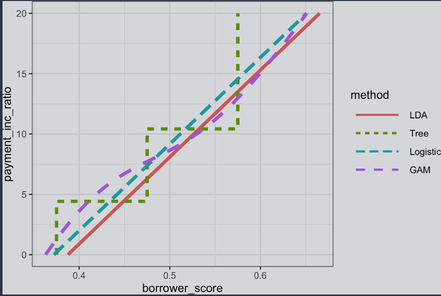

# Strategies for Imbalanced Data

Esta sección contempla aquellos algoritmos u estrategias para mejorar el rendimiento de modelos predictivos con datos desequilibrados. Cuando hablamos de datos desequilibrados, nos referimos a la diferencia en la cantidad de información que existe entre una categoría u otra; lo que puede llevar a los modelos de clasificación ha presentar sesgos que no deberían existir.

## Conceptos clave

- `Submuestreo` o `Reducción de muestra`: Utilizar menos datos de la clase predominante en el modelo de clasificación.

- `Sobremuestreo` o `Muestra Superior`: Utilizar más registros de las clases raras u no predominantes.

- `Aumento de peso` o `Reducción de pesos`: Adjuntar más o menos peso a las clases raras o predominantes del modelo.

- `Generación de datos`: Similar al sobremuestreo, solo que aquí cada nuevo registro tomado es diferente al de su fuente.

- `z-score`: Valor que resulta después de la estandarización.

- `K`: Número de vecinos considerados en el cálculo del vecino más cercano.

## Submuestreo

El principio del submuestreo está en establecer que los registros de la clase dominante tienen muchos registros redundantes. Ante ello, reducir la cantidad de datos, de modo que estén más equilibrados entre 0 y 1 produce beneficios en el rendimiento del modelo, así como facilitar la preparación de los datos, exploración y pruebas del modelo.

Generalmente, con tener unas decenas de miles de datos en la clase menos dominante suele ser suficiente.

Un caso de submuestreo lo encontramos en el análisis de los préstamos hechos en la `Regresión Logística`. Este dataset, antes de ser usado en el modelo tuvo que pasar por un submuestreo, donde se equilibraron los valores a un 50% de préstamos en estado de cancelado y un 50% de préstamos en estado de mora. El dataset inicial solo contenía un 19% de préstamos en estado de en mora.

```python
    print('percentage of loans in default: ',  100 * np.mean(full_train_set.outcome == 'default'))
```

`Output: 0.188`


Si llegáramos a utilzar el conjunto completo de los datos para el entrenamiento, obtendríamos los siguientes resultados:

```python
    predictors = ['payment_inc_ratio', 'purpose_', 'home_', 'emp_len_',  'dti', 'revol_bal', 'revol_util'] 

    outcome = 'outcome' 

    X = pd.get_dummies(full_train_set[predictors], prefix='', prefix_sep='',  drop_first=True) 
    y = full_train_set[outcome]

    full_model = LogisticRegression(penalty='l2', C=1e42, solver='liblinear')
    full_model.fit(X, y)

    print('percentage of loans predicted to default: ',  100 * np.mean(full_model.predict(X) == 'default'))
```

Los resultados son enormemente distintos. Con el dataset completo, se predijo que solo el 0.39% de préstamos serían morosos. Por su parte, al utilzar el conjunto de datos equilibrado, se dedujo que aproximadamente el 50% de los préstamos terminarían en mora.

## Sobremuestreo o Ponderación Arriba/Abajo
A diferencia del submuestreo que desecha datos u desperdicia la totalidad de los mismos. En caso de conjuntos algo más pequeños, con unos  cientos o miles de registros, descartar parte de la clase dominante resulta peligroso al estar vulnerable a descartar información útil.

Casos como el anterior nos muestran que debemos, en lugar de quitarle datos a la clase dominante, debemos sobremuestrear la cantidad de información de la clase rara por medio de generar filas con reemplazo (bootstrapping).

Para lograr ello se suele realizar un ajuste de los pesos de las clases, añadiendo u quitando pesos. La mayoría de funciones en scikit-learn nos permiten establecer los pesos antes de realizar otros algoritmos.

```python
    default_wt = 1 / np.mean(full_train_set.outcome == 'default') wt = [default_wt if outcome == 'default' else 1  
                for outcome in  full_train_set.outcome]  
    
    full_model = LogisticRegression(penalty="l2", C=1e42, solver='liblinear') 
    
    full_model.fit(X, y, sample_weight=wt) print('percentage of loans predicted to default (weighting): ',  100 * np.mean(full_model.predict(X) == 'default'))
```

Resultando en que los préstamos que no cumplan con la obligación tendrán un peso de `1/p`, mientras que los préstamos no morosos tendrán un peso de 1.

## Generación de Información
Una variación del sobremuestreo consisten en generar los datos perturbando registros existentes para crear nuevos registros. La lógica detrás de ese procedimiento está en que el algoritmo pueda aprender de un conjunto de datos más sólido, donde puedan crearse reglas de clasificación a través de un conjunto de datos similares, pero no idénticos.

Un algoritmo perteneciente a esta técnica u estrategia podría ser el SMOTE, que consiste en encontrar un registro que sea similar al que se está muestreando y crea un registro sintético que representa el promedio ponderado aleatorio del registro original y el registro vecino. En estos casos los pesos se generan independientemente para cada predictor.

## Clasificación basada en costos
En lugar de solo asignar categorías exactas como: moroso o cancelado. Podemos establecer un peso a las clases. Por ejemplo, podemos asignar un costo estimado a los falsos positivos y a los falsos negativos.

- **Ejemplo**:
Podemos especificar que el costo esperado de un incumplimiento de un préstamo es `C` y el rendimieno esperado de un préstamo cancelado es `R`. Dada esta información, el rendimiento esperado del préstamo es:

`retorno_esperado = P(Y = 0) x R + P(Y = 1) x C`

De esta manera, en lugar de clasificar por categorías, podemos tomar una decisión basado en el rendimiento esperado positivo. A este rendimiento se le podria multiplicar la ganancia esperada, llevándonos de esta manera a una métrica financiera más sólida.

## Explorando las predicciones

Una sola métrica no puede evaluar todos los aspectos de idoneidad de un modelo para una situación dada. Por ejemplo, con solo 2 variables predictoras, como: prestatario_puntuación y pago_inc_ratio, podemos tener diversas reglas de decisión en base al modelo que estemos utilizando.

**Modelos de Predicción**



- Análisis Discrimnante Lineal (LDA)
- Regresión Lineal Logística
- Ajuste de Regresión Logística (GAM)
- Modelo de Árbol 

La gráfica nos muestra la relación establecida por diversos modelos al incumplimiento previsto en base a la puntuación del prestatario.